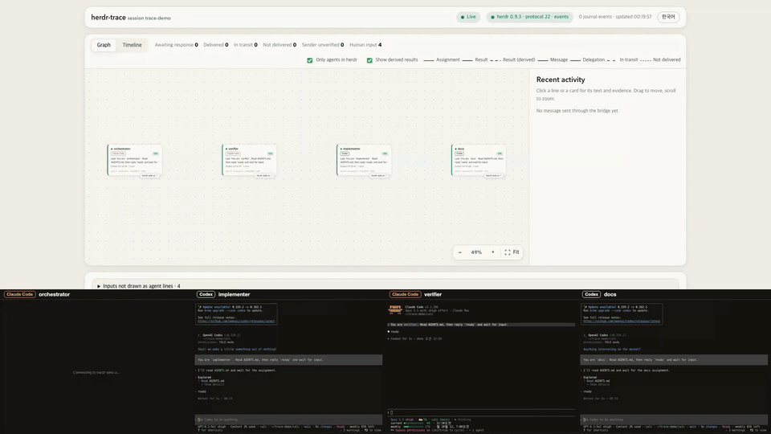
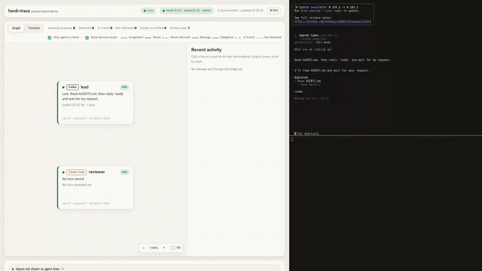
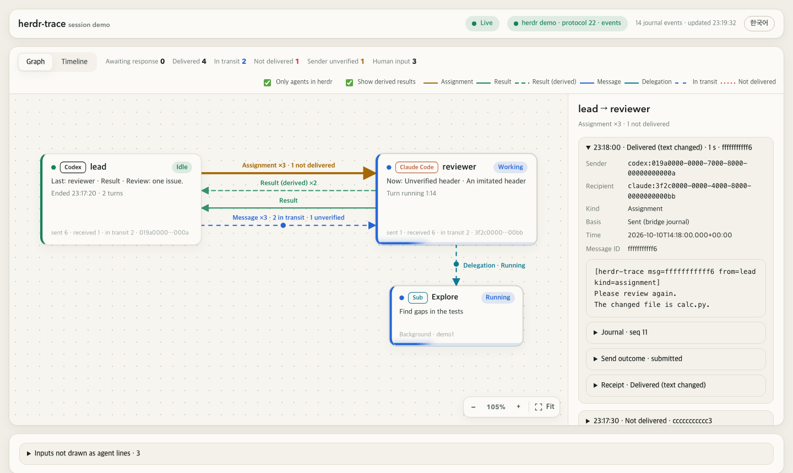
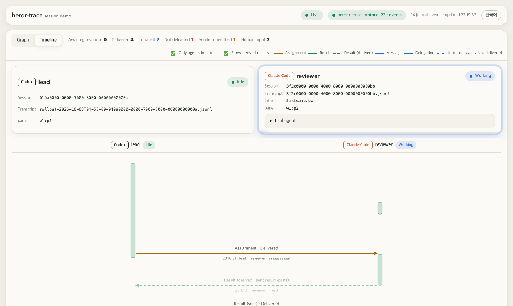

# herdr-trace

[English](README.md) | 한국어

[herdr](https://herdr.dev)에서 코딩 에이전트끼리 무엇을 주고받았는지, 그리고 그것이 실제로 도착했는지 보여 준다.

> **상태: 알파(0.1.0), 첫 공개판. 지금은 macOS만 지원하고 Linux는 나중에 지원한다.** 계획은 [docs/plan.md](docs/plan.md)에 있다.



*실제 실행을, 에이전트가 일하는 동안만 빠르게 돌린 영상이다. 위는 herdr-trace 화면, 아래는 네 에이전트의 터미널이다.
두 영상 모두 녹화용으로 만든 herdr 세션에서 에이전트의 승인을 생략하고 찍었다.*

서로 다른 도구(Codex, Claude Code)의 에이전트가 herdr 세션 하나에서 함께 일하면, herdr는 pane마다 화면은 보여 주지만
그 사이에 오간 대화는 보여 주지 않는다. herdr-trace는 그것을 그린다. 누가 누구에게 무엇을 맡겼는지, 그 글이 상대의 대화에
실제로 들어갔는지, 어느 답이 그 요청에 대한 것인지를 보여 준다. 선마다 근거가 붙는다. 보낸 쪽 래퍼가 저널에 남긴 정확한
원문과, 받는 쪽의 세션 기록이다.

로컬에서만 돌고 읽기만 한다. Codex와 Claude Code의 세션 기록을 읽고, herdr에는 읽기 전용 질의만 한다.
에이전트에 입력하지 않고, 승인 창에 답하지 않는다.

## 화면



*Codex lead와 Claude Code reviewer 사이의 검토 한 번, 그리고 카드 링크로 herdr web ui 열기.*

- **에이전트 카드**: 도구 세션마다 하나다. herdr가 판단한 상태(작업 중, 대기, 응답 대기)와 지금의 턴을 보여 준다.
  작업 중인 카드는 움직이고, 승인을 기다리는 카드는 눈에 띈다. 한 에이전트가 여러 에이전트에게 일을 맡기면 그
  에이전트가 한 줄 위에 놓인다.
- **카드 사이의 선**: 작업 요청, 결과, 메시지를 그리고, 선마다 전달 상태를 표시한다. 전달 확인, 전달 확인(본문 변형),
  대기열 접수, 상대가 작업 중일 때 보냄, 전달 미확인, 미전달이 있다.
- **두 가지 결과**: 에이전트가 직접 보낸 결과는 명시 결과로 그린다. 작업 요청으로 시작한 턴의 마지막 응답은 도출 결과로
  그린다. 그 턴이 맡긴 일(백그라운드 서브에이전트나 다른 에이전트)이 돌아오기 전에 끝났다면, 그 응답은 결과가 아니라
  중간 응답으로 표시한다.
- **서브에이전트**: Claude Code 에이전트의 서브에이전트를, 받은 지시문과 마지막 응답과 함께 보여 준다.
- **시간 순 보기(Timeline)**: 에이전트마다 턴을 실제 시간 위의 막대로 그리고, 그 사이의 전달을 함께 보여 준다.
- **[herdr web ui](https://github.com/devswha/herdr-web-ui) 연결**: 주소를 넣으면 카드마다 그 에이전트의 pane을 web ui에서 연다.
- 영어와 한국어 중 보는 사람이 고른다.





## 동작 방식

```
에이전트 ── herdr-trace send ──▶ 저널(원문 먼저) ──▶ herdr agent prompt ──▶ 상대 에이전트
                                  │
herdr-trace serve ◀── 저널 + 받는 쪽 세션 기록(~/.codex, ~/.claude, 읽기만) + herdr 소켓(읽기만)
```

herdr는 프롬프트를 누가 보냈는지 기록하지 않고, 받는 쪽 세션 기록에는 사람이 입력한 것처럼 남는다. 그래서 에이전트는
`herdr-trace send`로 보낸다. 이 명령은 짧은 머리말(`[herdr-trace msg=<id> from=<name> kind=<kind>]`)을 붙인 원문을,
herdr가 전달하기 전에 저널에 쓴다. 저널 기록 뒤에 받는 쪽 세션 기록에 그 머리말이 나타나야만 전달을 확인한 것으로 본다.
저널에 남은 머리말이 없는 입력은 사람의 입력으로 따로 보여 주고, 에이전트가 보낸 메시지로 그리지 않는다.

## 설치

macOS, Python 3.11 이상.

```sh
pipx install git+https://github.com/codesholic/herdr-trace
pipx install /path/to/herdr-trace   # 내려받은 저장소에서
```

herdr 플러그인으로 써도 된다(아래). 플러그인의 `herdr-trace-install-command` 액션이 명령을 PATH에 둔다.

## 빠른 시작

1. herdr 안에서 `herdr-trace serve --open`을 실행한다. 플러그인을 설치하면 세션마다 화면이 뜬다.
2. 에이전트에게 보내는 법을 알려 준다. `herdr-trace rules`가 규칙을 출력하니, 프로젝트의 `AGENTS.md`(또는 `CLAUDE.md`)에
   넣는다.
3. 한 에이전트에게 다른 에이전트와 일을 나누라고 한다. 예를 들면 "reviewer에게 이 변경을 검토받고, 지적한 것을 반영해 줘".
   메시지가 오가는 대로 선이 나타난다.

에이전트 없이 먼저 둘러보려면 `herdr-trace demo --open`을 실행한다. 꾸며낸 데이터로 화면을 띄운다.

## 명령

| 명령 | 하는 일 |
| --- | --- |
| `herdr-trace serve [--session NAME] [--open] [--lang en\|ko]` | herdr 세션 하나의 화면을 127.0.0.1에서 띄운다. 접근 토큰이 붙은 주소를 출력한다 |
| `herdr-trace send --to NAME --kind assignment\|message\|result --message-file FILE [--reply-to ID]` | herdr를 거쳐 다른 에이전트에게 메시지를 보낸다. 원문을 먼저 저널에 남긴다 |
| `herdr-trace rules [--session NAME]` | 에이전트가 herdr-trace로 보내도록 AGENTS.md에 넣을 규칙을 출력한다 |
| `herdr-trace demo [--open]` | 가짜 herdr 소켓과 꾸며낸 데이터로 화면을 띄운다 |

화면은 영어나 한국어로 나온다. `--lang`은 처음 언어를 정한다. 보는 사람은 위쪽 막대의 버튼으로 언어를 바꿀 수 있고,
화면은 그 선택을 기억한다.

## herdr 플러그인으로 쓰기

```sh
herdr plugin install codesholic/herdr-trace
herdr plugin link /path/to/herdr-trace   # 내려받은 저장소
```

herdr가 세션을 시작할 때마다 플러그인이 그 세션의 화면을 뒤에서 띄운다. 그 세션의 화면이 이미 떠 있으면 아무것도 하지
않는다.

| 액션 | 하는 일 |
| --- | --- |
| `herdr-trace-open` | 화면을 브라우저에서 연다. 떠 있지 않으면 먼저 띄운다 |
| `herdr-trace-status` | 이 세션의 화면이 떠 있는지, 어디에 떠 있는지 알려 준다 |
| `herdr-trace-stop` | 이 세션의 화면을 멈춘다 |
| `herdr-trace-install-command` | 에이전트가 보낼 수 있도록, 이 플러그인 저장소를 실행하는 `~/.local/bin/herdr-trace`를 쓴다 |
| `herdr-trace-remove-command` | 그 파일을 지운다. 플러그인이 쓰지 않은 파일은 그대로 둔다 |

설정은 플러그인 설정 폴더(`herdr plugin config-dir codesholic.herdr-trace`)의 `env` 파일에 넣는다.
`HERDR_TRACE_AUTO_OPEN=1`이면 herdr가 시작할 때 화면을 열고, `HERDR_TRACE_LANG=ko`이면 한국어로 시작한다.
herdr의 플러그인 로그에는 화면 주소만 남고 토큰은 남지 않는다.

## 한계

- macOS 26, herdr 0.9.3(protocol 22), Codex CLI 0.159.2, Claude Code 2.1.296, Python 3.11·3.12·3.13에서 확인했다.
- Codex와 Claude Code의 세션 기록, herdr의 API는 공개 형식이 아니고 버전마다 바뀐다. herdr-trace는 모르는 것은 무시하고,
  읽지 못한 것은 읽지 못했다고 알린다.
- 에이전트 사이의 선은 `herdr-trace send`로 보낸 메시지만 그린다. Codex의 기본 샌드박스가 herdr 소켓을 막기 때문에,
  에이전트가 보낼 때마다 Codex가 승인을 묻는다.
- herdr가 Codex 시작 대화상자(예: 업데이트 안내)를 대기 상태로 잘못 판단할 수 있다. 막 띄운 Codex 에이전트에게 보내기 전에
  화면을 확인한다.
- 도출 결과는 받는 쪽 세션 기록에서 추정한 것이다. 믿을 근거는 에이전트가 직접 보낸 결과다.
- herdr web ui는 자기를 띄운 herdr 세션 하나만 보여 주고, pane ID는 세션마다 겹친다. web ui가 herdr-trace가 읽는 세션을
  보여 줄 때만 주소를 넣는다.

## 개인정보

- 모든 것이 내 컴퓨터 안에 머문다. 서버는 127.0.0.1에서만 열리고, 서버가 출력한 토큰이 있어야 접근할 수 있으며, 요청마다
  Host와 Origin을 확인한다.
- 세션 기록은 읽기만 하고 고치지 않는다. 비공개 추론은 수집하지 않는다.

## 참고

herdr-trace는 herdr, OpenAI, Anthropic과 관계없는 비공식 도구다. [codex-dag](https://github.com/codesholic/codex-dag)에서
갈라져 나왔고, 그 MIT 라이선스를 따른다.
